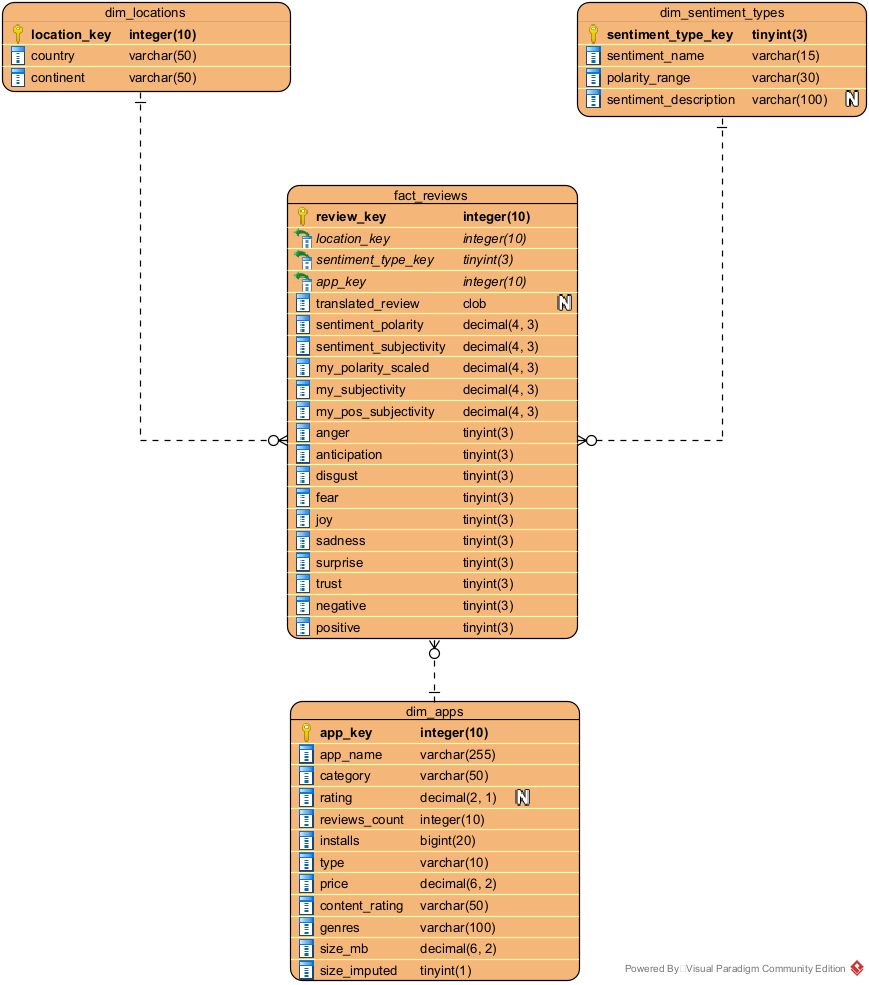
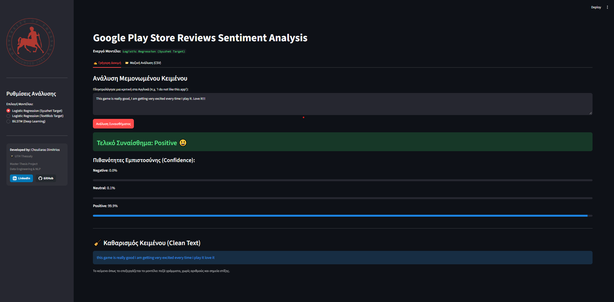

# Google Play Store Analytics: End-to-End BI, Data Warehouse & NLP Pipeline

[](01_r_data_prep_nlp/)
[](02_mysql_data_warehouse/)
[](03_powerbi_dashboards/)
[](04_python_ml_streamlit/)
[](04_python_ml_streamlit/app.py)

> **Master's Thesis Project** — MSc in Software Engineering for Internet and Mobile Applications, University of Thessaly  
> **Author:** Dimitrios Chouliaras ([GitHub](https://github.com/Dimitris-Chouliaras))

---

## Overview / Περιγραφή

**EN:**  
This repository presents an end-to-end **Data Engineering, Business Intelligence, and Natural Language Processing (NLP)** pipeline built on the Google Play Store dataset. The project transforms raw application metadata and user reviews into a relational **Star Schema Data Warehouse**, interactive **Power BI dashboards**, and predictive **Machine Learning / Deep Learning** sentiment models deployed via **Streamlit**.

**EL:**  
Το αποθετήριο αυτό παρουσιάζει μια ολοκληρωμένη ροή **Data Engineering, Business Intelligence (BI) και Επεξεργασίας Φυσικής Γλώσσας (NLP)** πάνω στα δεδομένα του Google Play Store. Τα ακατέργαστα δεδομένα εφαρμογών και κριτικών μετασχηματίζονται σε σχεσιακή **Αποθήκη Δεδομένων (Star Schema)**, διαδραστικά **Power BI dashboards** και μοντέλα **Μηχανικής / Βαθιάς Μάθησης** πρόβλεψης συναισθήματος σε εφαρμογή **Streamlit**.

---

## System Architecture / Αρχιτεκτονική Συστήματος

The workflow is organized into four modular layers:

1. **Layer 1 — Data Preparation & Lexicon NLP (`01_r_data_prep_nlp/`):**
   * Data cleaning, schema standardization, deduplication, and quality auditing in **R**.
   * Lexicon-based sentiment and emotion analysis (**Syuzhet**, **NRC**, **TextBlob**) and geographic simulation (`locations.csv`).
2. **Layer 2 — Relational Data Warehouse (`02_mysql_data_warehouse/`):**
   * **MySQL** Star Schema design (`fact_reviews`, `dim_apps`, `dim_locations`, `dim_sentiment_types`).
   * Automated ELT staging/loading scripts and B-Tree index optimization for analytical queries.
3. **Layer 3 — Business Intelligence & Visual Analytics (`03_powerbi_dashboards/`):**
   * **Power BI** data modeling and custom **DAX** KPIs across 4 interactive dashboards (Overview & Free vs. Paid comparison, Geographic distribution, Rating/Install drivers, and Multi-app benchmarking).
4. **Layer 4 — Predictive Modeling & Web App (`04_python_ml_streamlit/`):**
   * Supervised sentiment classification comparing **TF-IDF + Logistic Regression** (`scikit-learn`) and a **BiLSTM** neural network (`TensorFlow/Keras`).
   * Interactive **Streamlit** web application (`app.py`) for real-time review inference and batch Excel/CSV scoring.

---

## Data Warehouse Schema (Star Schema)



---

## Visual Previews / Ενδεικτικά Στιγμιότυπα

### Power BI Dashboards
| Overview & App Deep-Dive | Geographic Sentiment & Category Analysis |
| :---: | :---: |
|  |  |

### Streamlit Sentiment Inference App


---

## Repository Structure / Δομή Αποθετηρίου

```text
google-play-store-bi-nlp/
├── 01_r_data_prep_nlp/          # R scripts for cleaning, profiling, NLP & geo-enrichment
├── 02_mysql_data_warehouse/     # MySQL DDL, ELT loading & indexing optimization scripts
├── 03_powerbi_dashboards/       # Power BI report (.pbix) with DAX measures & 4 dashboards
├── 04_python_ml_streamlit/      # TF-IDF LogReg, BiLSTM training/models & Streamlit app
├── assets/                      # Architecture diagrams, model plots & dashboard screenshots
├── data_clean/                  # Processed datasets & train/test splits ready for SQL/ML
├── data_raw/                    # Original Kaggle Google Play Store CSV files
└── Χουλιάρας Δημήτριος διατριβή.pdf  # Full Master's Thesis report (Greek)